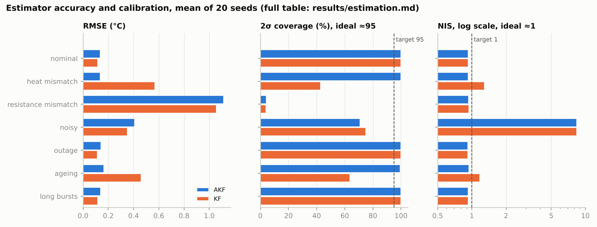
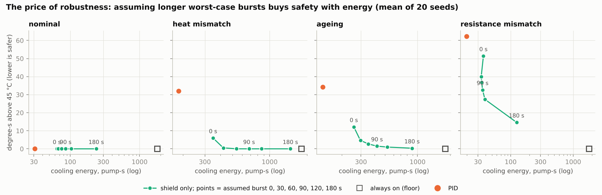
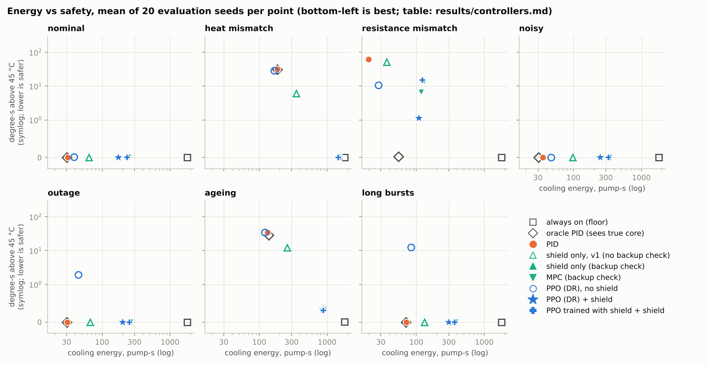
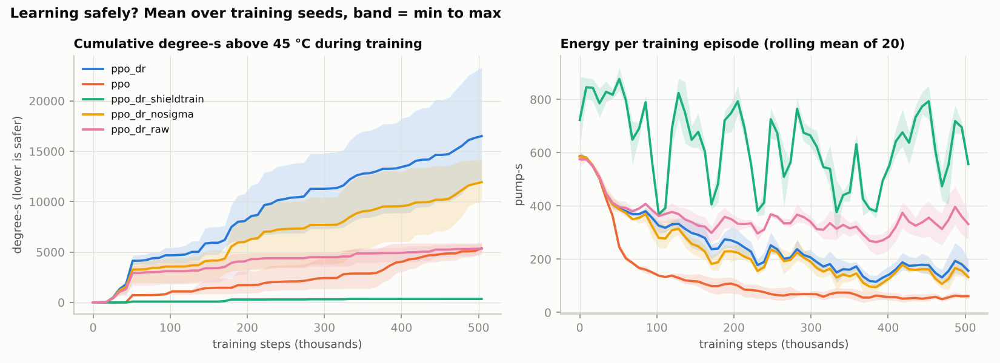

# Safe RL for Battery Thermal Management under Partial Observability

A small demo of physics-informed state estimation and safe adaptive control for thermal management, using a battery cell as the example.

**Problem.** Keep a battery cell's **core temperature ≤ 45 °C** with as little cooling energy as possible. Only the **surface** temperature is measured, with noise and occasional sensor outages, and the model may be wrong. The demo touches four research questions:
- **RQ1:** estimating the unmeasured core temperature with calibrated uncertainty
- **RQ2:** safe RL with an uncertainty-aware safety shield
- **RQ3:** whether combining estimation and control helps
- **RQ4:** robustness to model error, sensor loss and conditions beyond training

> **Status:** all parts of the plan are implemented and evaluated: the estimators (RQ1), the non-RL controllers, and five PPO variants × 3 training seeds (RQ2–RQ4).

**Main results in one paragraph.**
- A Kalman filter that also estimates the cell's heat generation can detect and correct "more heat than expected", but **no filter can see a wrong core-to-surface resistance from a surface sensor**.
- A safety shield that plans for a worst-case current burst keeps the core below 45 °C wherever the estimate is right.
- **PPO behind that shield gives the best trade-off overall.** It is as safe as the shield and MPC where they are safe, uses **less energy than shield-only in all 20 nominal episodes (median −26 %)**, and violates less often under the undetectable resistance error.
- PPO alone is not safe. Training with the shield in the loop makes learning almost violation-free, but the policy then learns to leave all the safety work to the shield.

## Model

Two-state lumped thermal model of a cylindrical cell:

```
Cc · dTc/dt = I²·R_int − (Tc − Ts)/Rc
Cs · dTs/dt = (Tc − Ts)/Rc − (Ts − Tf)·(h0 + h1·u)
```

- Tc is the core temperature (not measured), Ts the surface temperature (measured, σ = 0.3 °C), and u ∈ [0, 1] the coolant pump command.
- Steady state at 25 A is 43.4 °C with full cooling and 78.8 °C with none, so cooling is necessary, but full cooling all the time wastes energy.
- Each 2 s step is discretised exactly with the closed-form 2×2 matrix exponential.

## RQ1: what a surface sensor can and cannot tell you

There are two filters, and both use the **nominal** model:
- **KF:** state [Tc, Ts].
- **AKF:** state [Tc, Ts, θ], where θ scales the heat generation (Q = θ·I²·R_int) and drifts slowly. This lets the filter learn "the cell makes more heat than the model thinks".




Each scenario was run for 20 seeds with full cooling, so that only the estimator differs. Full numbers are in [results/estimation.md](results/estimation.md). In the table, bias = estimate − true.

| Scenario | Finding |
|---|---|
| Heat mismatch (R_int ×1.3) | **Visible and fixable.** The plain KF reads 0.48 °C low and its 2σ band covers the truth only 43 % of the time. Its innovations reveal the problem without a core sensor: NIS 1.29 instead of ≈1, mean innovation 0.52 instead of ≈0. The AKF estimates θ = 1.31 and is back to 0.14 °C RMSE with full coverage. |
| Resistance mismatch (Rc ×1.2) | **Invisible.** Both filters read about 1.0 °C low and cover the truth only 4 % of the time, yet the innovations look perfectly normal (NIS 0.94). At steady state Ts − Tf = Q/h whatever Rc is, so the surface sensor carries no information about Rc. A safety layer that trusts σ will be overconfident here. This motivates active probing (dual control) as future work. |
| Noisy sensor (×3) | The filters assume σ = 0.3 °C, and NIS jumps to 8.4, so the wrong noise assumption is detectable. Coverage drops to 71–75 %. |
| Ageing (R_int ×1.0 → ×1.4) | The KF drifts (64 % coverage). The AKF tracks it (θ̂ = 1.32 at the end, lagging the true 1.4; 99 % coverage). |
| Outage (sensor offline 30–120 s, ~20 % of the time) | Both filters stay accurate with full cooling. Outages matter more once the controller relies on the estimate. |
| Nominal | Accurate (0.12–0.14 °C RMSE), but **conservative**: NEES is 0.4 where a calibrated filter gives 2, so σ is wider than the real error. The process noise (0.05 °C per step) is a tuning choice; a smaller value would tighten σ but make the mismatch cases even more overconfident. |

## Controllers without RL (RQ2, RQ4 baselines)

All controllers act on the AKF estimate, except the oracle PID, which sees the true core temperature (impossible in practice; a reference only).

| Controller | Rule |
|---|---|
| Always on | u = 1 all the time. The physical floor for violations. |
| PID | On the core estimate, setpoint 42 °C. The gains come from a grid search on separate tuning seeds (1000–1019) using the RL reward's weights; the search chose a proportional controller (kp = 0.3, ki = kd = 0). |
| Oracle PID | The same PID, but fed the true core temperature. |
| Shield only, v1 | The cheapest u that keeps the predicted core mean + 2σ ≤ 44 °C over the next 30 s, assuming the current stays constant. This is the original plan's shield. |
| **Shield only** | v1 plus a **backup check**: hold u for 30 s, then survive a worst-case burst (25 A for 180 s, the drive-cycle maximum) with full cooling, still with mean + 2σ ≤ 44 °C. It uses the AKF's heat-scale estimate θ, so a cell that runs hot automatically gets a larger reserve. |
| MPC | Plans 60 s ahead (216 candidate plans, 3 blocks of 20 s), minimising Σu³·dt subject to the same safety rule as the shield. |

20 evaluation seeds per cell (full tables: [results/controllers.md](results/controllers.md); the energy-vs-safety figure is in the RL section below):

| Scenario | Finding |
|---|---|
| Nominal, noisy, outage | **Everyone is safe.** PID is cheapest (31 pump-s); the backup shield and MPC use about 8× more (237–245) as insurance against bursts that never cause trouble here. |
| Heat mismatch (R_int ×1.3) | PID **and the oracle PID** exceed 45 °C in 85 % of episodes: knowing the true core temperature doesn't help a controller that only reacts. The v1 shield fails in 40 %. **The backup shield: 0 %**, using 18 % less energy than always-on (1471 vs 1800). |
| Ageing (R_int → ×1.4) | The backup shield's only violating episode (seed 17) is the one where even always-on exceeds 45 °C, though the shield exceeds by more (6.8 vs 0.03 degree-seconds). PID: 75 % of episodes. |
| Resistance mismatch (Rc ×1.2) | **Every controller that uses the estimate fails** (60–80 % of episodes), but the oracle PID does not (5 %). The estimate itself is wrong (RQ1), and no downstream safety logic can fix that. |
| Long bursts (360 s, beyond the shield's 180 s assumption) | No violations by any controller on the nominal plant. |

**How the shield design changed during evaluation.** These changes were made on the tuning seeds and then confirmed on the evaluation seeds:
1. The v1 shield failed under heat mismatch even with an accurate estimate (error about 0.1 °C, θ̂ = 1.30). A burst arrived while the core was already warm, and from there even full cooling could not keep it below 45 °C. A 30 s look-ahead with constant current cannot see this coming. Hence the backup check.
2. With a one-step hold, the backup check made the command chatter between low and full cooling. Holding the candidate for 30 s gave the same safety with 25 % less energy and far fewer on/off switches.

**The price of robustness.** The assumed worst-case burst length is a dial between energy and safety. There is no free lunch:



This is where learning could help: a policy that anticipates load, or a load forecast, could keep the same safety at lower cost than "assume the worst at every moment". It also explains why PID beats the shield on energy in the nominal case. Under a u³ cost, gentle early cooling is cheaper than late hard cooling, and the shield and MPC cool late and hard. One episode per controller: [nominal](results/trajectory_nominal.png), [resistance mismatch](results/trajectory_resistance_mismatch.png).

## Reinforcement learning (RQ2–RQ4)

**Setup.** PPO (stable-baselines3, 64×64 MLP) is trained for 500k steps per run, with 3 training seeds per variant. Each run takes about 3 minutes on one CPU core, or about 6.5 minutes with the shield in the loop.
- **Reward:** −u³ − 10·max(0, Tc − 45) − 0.01·|Δu|. It uses the true core temperature, which only the simulator knows.
- **Observation:** the policy never sees the true core temperature. It gets the AKF estimate, its σ, θ̂, the last surface reading, the sensor-online flag, the current and the previous u.
- **Training conditions:** extra sensor noise in every episode and outages in half of them. Domain randomisation (DR) also draws R_int ×0.8–1.3 and Rc ×0.8–1.2 per episode.
- **Evaluation:** every policy is tested on the same 7 scenarios × 20 seeds as the other controllers, with and without the shield.

| Variant | What it tests |
|---|---|
| `ppo_dr` | main policy: full observation, domain randomisation |
| `ppo` | same without DR (what DR buys) |
| `ppo_dr_shieldtrain` | shield active during training (safe exploration) |
| `ppo_dr_nosigma`, `ppo_dr_raw` | RQ3: no σ in the observation; no estimator at all (last 10 surface readings) |



Key numbers (mean over 20 evaluation episodes; for PPO, also over 3 training seeds, with the per-seed range in brackets):

| | Nominal energy (pump-s) | Heat mismatch: episodes > 45 °C | Resistance mismatch: episodes > 45 °C | Resistance mismatch: degree-s |
|---|---|---|---|---|
| PID | 31 | 85 % | 80 % | 62.4 |
| Shield only | 237 | 0 % | 65 % | 14.7 |
| MPC | 245 | 0 % | 60 % | 6.6 |
| PPO (DR), no shield | 39 [19–69] | 43 % [0–75 %] | 32 % [0–60 %] | 10.6 |
| **PPO (DR) + shield** | **174 [167–185]** | **0 %** | **22 % [0–50 %]** | **1.1** |

What we found:

1. **PPO + shield beats the shield and MPC on energy at equal safety.** It uses less energy than shield-only in every one of the 20 episodes in the nominal, noisy and long-burst scenarios (median saving 19–26 %), and less than MPC in 79 of 80 episodes across the four scenarios where all three are safe. The [trajectory figure](results/trajectory_nominal.png) shows why: PPO cools early and gently, so the shield rarely needs to step in, whereas the shield on its own (and MPC) cool late and hard, which costs more under u³. Under heat mismatch and ageing the shield dominates, and all shielded controllers spend about the same energy.
2. **It also violates less under the undetectable resistance mismatch:** 22 % of episodes vs 65 % (shield only) and 60 % (MPC). The improvement holds for all three training seeds, but the range is wide (0–50 %). A likely reason: trained with a randomised Rc, the policy learned to keep some extra margin that the model-based controllers have no reason to keep.
3. **PPO alone is not safe.** Even with DR, it exceeds 45 °C in 43 % of heat-mismatch episodes, 37 % under ageing, 13 % with long bursts and 2 % in the nominal case. A penalty in the reward is not a safety guarantee.
4. **Domain randomisation matters for robustness.** Without DR, PPO violates in 82 % of heat-mismatch episodes with 642 degree-s on average (29 with DR). With the shield, both are safe.

### RQ3: what should the policy observe?


- **The estimate buys efficiency.** With the AKF estimate, PPO needs 30–39 pump-s in the nominal case. With only raw surface readings it needs 206, because without an estimate of the core it cools much more to be safe.
- **σ helps a little, mostly under resistance mismatch:** 32 % vs 52 % of episodes violate without the shield, and 22 % vs 40 % behind it. The seed-to-seed ranges overlap, so treat this as a weak effect.
- **The surprise: the raw-observation policy is the safest PPO.** It has no violations in any scenario apart from the one physically unavoidable ageing episode, including resistance mismatch, where the estimate misleads every estimator-based controller. Using the estimator makes control efficient, but the controller then shares the estimator's blind spot. This is a concrete argument for RQ3's joint view of estimation and control.

### Safe exploration: training with the shield



| Variant | Degree-s above 45 °C during training | Training episodes with a violation |
|---|---|---|
| PPO (DR) | 16 511 ± 6 004 | 17.4 % |
| PPO (DR), shield in the loop | **346 ± 6** | **1.8 %** |

Training with the shield in the loop cuts over-temperature during learning by 98 %. The remaining 1.8 % are probably randomised cells that can't be kept below 45 °C at all. **But the policy learned to leave the safety work to the shield.** Its own action is nearly "no cooling": without the shield at test time it exceeds 45 °C in 38–100 % of episodes depending on the scenario (85 % in the nominal case), and with the shield it is no better than shield-only (235 vs 237 pump-s in the nominal case). The intervention penalty (0.1 per unit of u) was too weak to teach it anything. A larger penalty or constrained RL (a Lagrangian on the shield's interventions) are natural next steps. Full table: [results/training_safety.md](results/training_safety.md).

**Convergence.** The energy per training episode was still falling slightly at 500k steps, so longer training might lower the PPO energies a little further. Training is cheap (about 3 min per run), so this is easy to check.

## Reproduce

```bash
pip install -r requirements.txt
python -m pytest -q                 # 19 checks: physics, discretisation, scenarios, filters, shield
python evaluate.py estimation       # RQ1: results/estimation.*, results/calibration.png (~30 s)
python evaluate.py tune-pid         # PID gain search on tuning seeds (~30 s on 4 cores)
python evaluate.py shield-sweep     # results/shield_tradeoff.* (~1 min on 4 cores)
python run_all.py                   # train 5 PPO variants x 3 seeds (~30-40 min on 4 CPU cores)
python evaluate.py training         # training-time safety: results/training_safety.*
python evaluate.py controllers      # all controllers incl. PPO: results/controllers.*, pareto.png, rq3_ablation.png
```

No GPU is needed. On free cloud machines, use `notebooks/colab_debug.ipynb` for a quick test and `notebooks/kaggle_train.ipynb` for the full run (Accelerator *None*, then *Save & Run All*, which keeps running after you close the browser).

## Code

| File | Contents |
|---|---|
| `thermal_env.py` | Cell parameters, exact discretisation, drive cycles, scenarios, `ThermalSim` (plant + estimator for one episode), `ObsBuilder` and the Gymnasium `ThermalEnv` |
| `estimators.py` | `KalmanFilter(augment=False/True)`: KF and AKF, plus batch open-loop forecasts for the shield and MPC |
| `controllers.py` | Always-on, PID / oracle PID, `Shield` with `BackupCheck`, shield-only, MPC, `PPOController` |
| `train.py` | One PPO run: variants, checkpoints every 50k steps, `--resume`, training-time safety log |
| `run_all.py` | All variants × seeds in parallel; skips finished runs, resumes unfinished ones, `--max-hours` |
| `evaluate.py` | Estimation study, PID tuning, controller comparison (incl. PPO), shield sweep, training safety |
| `notebooks/` | Colab (debug) and Kaggle (full training) notebooks |
| `tests/test_physics.py` | Unit tests: physics, filters, shield, and the RL environment (incl. train/eval observation match) |

Seeds: evaluation uses seeds 0–19; tuning (PID gains, shield design choices) used seeds 1000–1019.

Parameter values for Cc, Cs and Rc follow a 26650 cylindrical cell from the lumped thermal-model literature (exact reference to be added). The cooling map h(u) is an assumption of this demo.

**Known limitations:** a lumped two-state model; an assumed cooling map; a privileged reward (training uses the true core temperature); the shield and MPC assume the current stays constant (apart from the worst-case burst in the backup check); the shield still switches more often than a real pump would like; the filter's σ is conservative in the nominal case (NEES 0.4); only 3 training seeds per PPO variant and 500k steps; and the MPC is a simple enumeration baseline (coarse input levels, no load preview), not a tuned industrial MPC.
