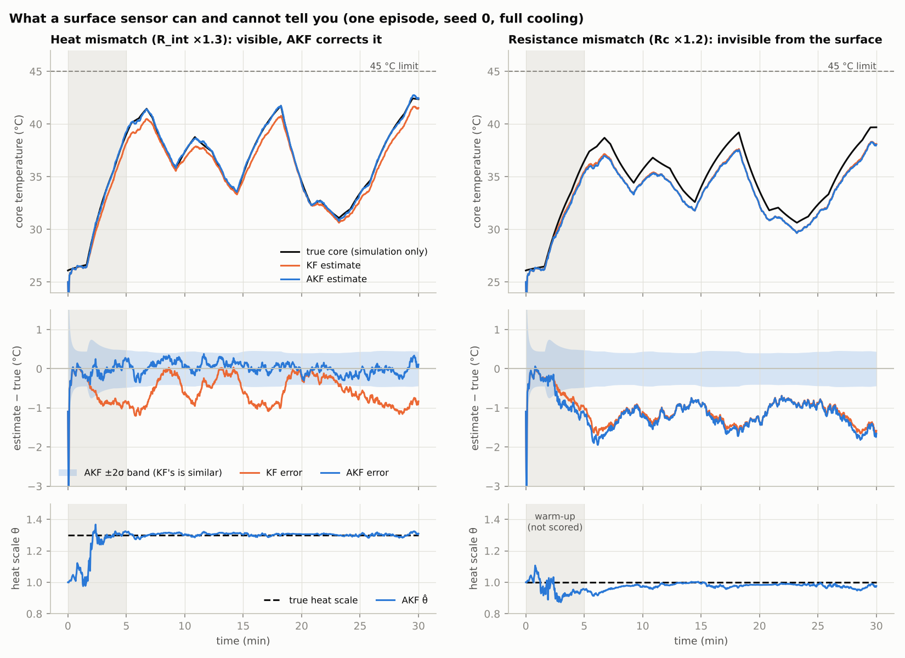

# Safe RL for Battery Thermal Management under Partial Observability

A small demo of physics-informed state estimation and safe adaptive control for thermal management, using a battery cell as the example.

**Problem.** Keep a battery cell's **core temperature ≤ 45 °C** with as little cooling energy as possible. Only the **surface** temperature is measured, with noise and occasional sensor outages, and the model may be wrong. The demo touches four research questions:
- **RQ1:** estimating the unmeasured core temperature with calibrated uncertainty
- **RQ2:** safe RL with an uncertainty-aware safety shield
- **RQ3:** whether combining estimation and control helps
- **RQ4:** robustness to model error, sensor loss and conditions beyond training

> **Status:** the physics model, both Kalman filters, the unit tests and the estimation study (RQ1) are done. The controllers (PID, shield, MPC) and RL training come next.

## Model

Two-state lumped thermal model of a cylindrical cell:

```
Cc · dTc/dt = I²·R_int − (Tc − Ts)/Rc
Cs · dTs/dt = (Tc − Ts)/Rc − (Ts − Tf)·(h0 + h1·u)
```

- Tc is the core temperature (not measured), Ts the surface temperature (measured, σ = 0.3 °C), and u ∈ [0, 1] the coolant pump command.
- Steady state at 25 A is 43.4 °C with full cooling and 78.8 °C with none, so cooling is necessary, but full cooling all the time wastes energy.
- Each 2 s step is discretised exactly with the closed-form 2×2 matrix exponential.

## RQ1: what a surface sensor can and cannot tell you

There are two filters, and both use the **nominal** model:
- **KF:** state [Tc, Ts].
- **AKF:** state [Tc, Ts, θ], where θ scales the heat generation (Q = θ·I²·R_int) and drifts slowly. This lets the filter learn "the cell makes more heat than the model thinks".




Each scenario was run for 20 seeds with full cooling, so that only the estimator differs. Full numbers are in [results/estimation.md](results/estimation.md). In the table, bias = estimate − true.

| Scenario | Finding |
|---|---|
| Heat mismatch (R_int ×1.3) | **Visible and fixable.** The plain KF reads 0.48 °C low and its 2σ band covers the truth only 43 % of the time. Its innovations reveal the problem without a core sensor: NIS 1.29 instead of ≈1, mean innovation 0.52 instead of ≈0. The AKF estimates θ = 1.31 and is back to 0.14 °C RMSE with full coverage. |
| Resistance mismatch (Rc ×1.2) | **Invisible.** Both filters read about 1.0 °C low and cover the truth only 4 % of the time, yet the innovations look perfectly normal (NIS 0.94). At steady state Ts − Tf = Q/h whatever Rc is, so the surface sensor carries no information about Rc. A safety layer that trusts σ will be overconfident here. This motivates active probing (dual control) as future work. |
| Noisy sensor (×3) | The filters assume σ = 0.3 °C, and NIS jumps to 8.4, so the wrong noise assumption is detectable. Coverage drops to 71–75 %. |
| Ageing (R_int ×1.0 → ×1.4) | The KF drifts (64 % coverage). The AKF tracks it (θ̂ = 1.32 at the end, lagging the true 1.4; 99 % coverage). |
| Outage (sensor offline 30–120 s, ~20 % of the time) | Both filters stay accurate with full cooling. Outages matter more once the controller relies on the estimate. |
| Nominal | Accurate (0.12–0.14 °C RMSE), but **conservative**: NEES is 0.4 where a calibrated filter gives 2, so σ is wider than the real error. The process noise (0.05 °C per step) is a tuning choice; a smaller value would tighten σ but make the mismatch cases even more overconfident. |

## Reproduce

```bash
pip install -r requirements.txt
python -m pytest -q                 # 17 checks: physics, discretisation, scenarios, filters
python evaluate.py estimation       # writes results/estimation.{csv,md,png}, results/calibration.png
```

## Code

| File | Contents |
|---|---|
| `thermal_env.py` | Cell parameters, exact discretisation, drive cycles, scenarios, `ThermalSim` (plant + estimator for one episode) |
| `estimators.py` | `KalmanFilter(augment=False/True)`: KF and AKF, plus batch open-loop forecasts for the shield and MPC |
| `evaluate.py` | Estimation study (more evaluations to come) |
| `tests/test_physics.py` | Unit tests: physics, discretisation, scenarios and filters |

Parameter values for Cc, Cs and Rc follow a 26650 cylindrical cell from the lumped thermal-model literature (exact reference to be added). The cooling map h(u) is an assumption of this demo.
