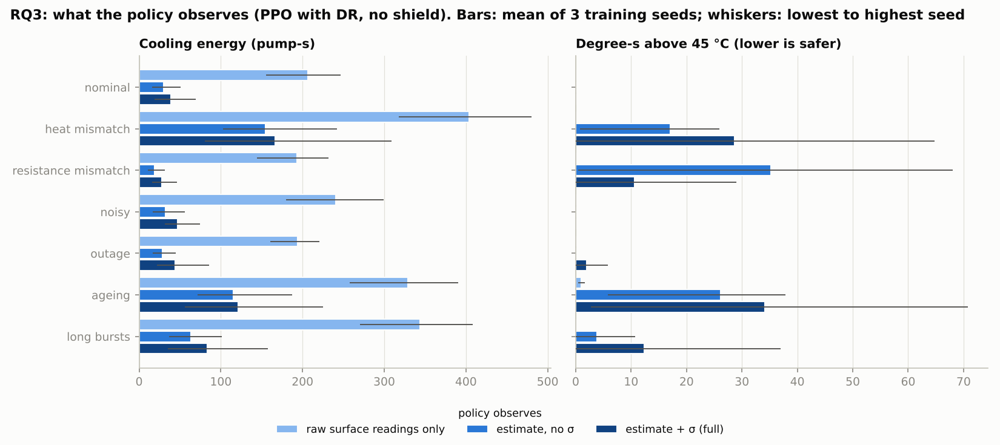

# Safe RL for Battery Thermal Management under Partial Observability

**English** | [简体中文](README.zh-CN.md)

A small, fully reproducible demo of physics-informed state estimation and safe adaptive control for thermal management, using a battery cell as the example.

**Problem.** Keep a battery cell's **core temperature ≤ 45 °C** with as little cooling energy as possible. Only the **surface** temperature is measured, with noise and occasional sensor outages, and the model may be wrong. The demo touches four research questions:
- **RQ1:** estimating the unmeasured core temperature with calibrated uncertainty
- **RQ2:** safe RL with an uncertainty-aware safety shield
- **RQ3:** whether combining estimation and control helps
- **RQ4:** robustness to model error, sensor loss and conditions beyond training

Everything runs on a laptop CPU: the full pipeline (6 PPO variants × 3 seeds × 1M steps, plus all evaluations) takes about an hour on 4 cores.

## Results at a glance

1. **A surface sensor can reveal some model errors but not others (RQ1).** A Kalman filter that also estimates the cell's heat generation detects and corrects "more heat than expected". But a wrong core-to-surface thermal resistance is **invisible**: the core estimate is about 1 °C too low while every consistency check looks normal.
2. **Safety comes from planning for the worst case (RQ2).** A shield that checks "could we still survive a worst-case current burst?" keeps the core below 45 °C in every scenario where the estimate is right. A shield that only looks 30 s ahead does not.
3. **PPO behind that shield gives the best energy at equal safety.** It uses 23 % less energy than the shield alone (median over episodes), and about as little as an MPC given a **perfect** 60 s forecast of the load. The policy learned to anticipate load and cool early and gently.
4. **Where the estimate is silently wrong, margin beats cleverness (RQ3).** Under the invisible resistance error, a simple PID that aims at 40 °C behind the shield, and a PPO policy that ignores the estimator, never exceed 45 °C. The estimator-based PPO policies do in 18–52 % of episodes. Using the estimator makes control efficient, but the controller then shares the estimator's blind spot.
5. **PPO on its own is not safe, and training with the shield teaches it to rely on the shield.** Shield-in-the-loop training cuts over-temperature during learning by about 97 %. Even with a 10× intervention penalty, though, the resulting policy is not safe without the shield.

| Controller | Nominal energy (pump-s) | Heat mismatch: episodes > 45 °C | Resistance mismatch: episodes > 45 °C |
|---|---|---|---|
| Always on (full cooling) | 1800 | 0 % | 0 % |
| PID | 31 | 85 % | 80 % |
| Shield only | 237 | 0 % | 65 % |
| MPC | 245 | 0 % | 60 % |
| MPC + perfect 60 s load preview | 190 | 0 % | 55 % |
| PID aiming at 40 °C + shield | 211 | 0 % | **0 %** |
| PPO (DR), no shield | 38 [24–59] | 50 % [5–75 %] | 30 % [0–55 %] |
| **PPO (DR) + shield** | **178 [174–186]** | **0 %** | 18 % [0–40 %] |
| PPO, raw surface readings only + shield | 382 | 0 % | **0 %** |

These are means over the same 20 evaluation drive cycles for every controller. For PPO they are also averaged over 3 training seeds, with the range across seeds in brackets. Energy is in pump-seconds: seconds of pumping at full power (always on = 1800). The controllers are explained in [The controllers in plain words](#the-controllers-in-plain-words), and "heat mismatch" and "resistance mismatch" in [Test scenarios](#test-scenarios). Full tables: [results/controllers.md](results/controllers.md).


## Model

Two-state lumped thermal model of a cylindrical cell [1, 2]:

```
Cc · dTc/dt = I²·R_int − (Tc − Ts)/Rc
Cs · dTs/dt = (Tc − Ts)/Rc − (Ts − Tf)·(h0 + h1·u)
```

- Tc is the core temperature (not measured), Ts the surface temperature (measured, σ = 0.3 °C), and u ∈ [0, 1] the coolant pump command. The pump uses power u³.
- Cc = 62.7 J/K, Cs = 4.5 J/K and Rc = 1.94 K/W are the values identified for a 2.3 Ah A123 26650 LiFePO4 cell in Table 1 of Lin et al. [2]. The cooling map h(u) = 0.15 + 0.85·u W/K is this demo's assumption; the convection resistance identified in [2] (Ru = 3.19 K/W, i.e. h ≈ 0.31 W/K) lies inside its range.
- Steady state at 25 A is 43.4 °C with full cooling and 78.8 °C with none, so cooling is necessary. A cell that makes 30 % more heat would reach 48.9 °C even with full cooling, so under sustained full load some violations are physically unavoidable.
- Each 2 s step is discretised exactly. The drive cycle is a random piecewise-constant current (0–25 A) with occasional bursts of 20–25 A lasting up to 180 s. Every controller is evaluated on the same 20 random drive cycles (seeds 0–19). Training uses fresh random cycles, and design choices were tuned on separate seeds (1000–1019).

## The controllers in plain words

| Method | What it does | Everyday analogy |
|---|---|---|
| Kalman filter (KF / AKF) | Estimates the core temperature, which cannot be measured, from the surface reading and the model, and says how sure it is (σ). The AKF also estimates how much heat the cell really makes. Every controller below except the oracle PID acts on this estimate. | A navigator estimating a ship's position from its speed, heading and the occasional landmark. |
| Always on | Full cooling all the time. Safe, but wasteful. | Running the air conditioner at maximum all day. |
| PID | A classic feedback controller: the further the estimated core is above its target, the harder it cools. Simple and cheap, but it only reacts after the temperature has already risen. | A thermostat. |
| Oracle PID | The same PID, but allowed to see the true core temperature. Impossible in practice; used only as a reference. | – |
| Safety shield | A safety check between a controller and the pump. Before each action it predicts the core temperature, with its uncertainty, and asks: "if I do this and then a worst-case current burst arrives, can full cooling still keep the core below 44 °C?" If not, it raises the cooling to the smallest safe amount. It never lowers the cooling. "Shield only" means the shield on its own, always choosing the least cooling it considers safe. | A car's automatic emergency braking: the driver drives, and the system only steps in to prevent a crash. |
| MPC (model predictive control) | Uses the model to try many cooling plans for the next 60 s, keeps the safe ones, picks the cheapest, applies only its first step, then plans again. Widely used in industry. "With load preview" means it is also told the future current. | Thinking a few moves ahead in chess, then thinking again after every move. |
| PPO (reinforcement learning) | A neural-network policy that learned by trial and error in simulation over a million steps, rewarded for using little energy and penalised for exceeding 45 °C. Once trained it decides instantly, but it has no built-in safety guarantee. "DR" (domain randomisation) means it was trained on many slightly different cells, so it copes better with model errors. | Learning to drive by practising in a simulator. |
| PPO + shield | The learned policy proposes the cooling, and the shield overrides it only when needed. The policy saves energy; the shield provides the safety. | A learner driver with an instructor who has a second brake pedal. |
| PID aiming at 40 °C + shield | A PID that aims well below the shield's 44 °C limit, so the shield rarely has to step in. The extra margin also covers errors the filter cannot see. | Keeping more than the minimum distance to the car in front. |

## Test scenarios

Every controller is tested in seven scenarios. In all of them, the estimators and controllers use the **nominal** model; only the simulated "real" cell or sensor changes.

| Scenario | What is different from the model | Possible real-world cause |
|---|---|---|
| Nominal | nothing | – |
| Heat mismatch | internal resistance R_int ×1.3, so the cell makes 30 % more heat than the model expects | ageing, low temperature, cell-to-cell variation |
| Resistance mismatch | core-to-surface thermal resistance Rc ×1.2, so heat escapes from the core more slowly than the model expects | manufacturing variation, changes in the cell's internal structure |
| Noisy | surface sensor noise ×3 | a poorer sensor or electrical interference |
| Outage | surface sensor offline for 30–120 s at a time, about 20 % of the time | loose connection, sensor fault |
| Ageing | R_int grows from ×1.0 to ×1.4 during the episode, beyond the range seen in training | battery degradation |
| Long bursts | full-load bursts last 180–360 s instead of at most 180 s | a load pattern never seen in training |

**Why the two mismatches behave so differently.** Think of the cell as a person in a jacket. The body is the core, which produces heat; the jacket is the thermal resistance Rc; and we can only measure the outside of the jacket.
- **Heat mismatch** is like the person exercising. More heat comes out, so the jacket surface gets warmer than predicted. The filter sees this surplus in its prediction errors (NIS), and the AKF corrects for it.
- **Resistance mismatch** is like a thicker jacket than assumed. The same heat still leaves through the surface, so the jacket surface looks exactly as predicted, but the body inside is hotter. At steady state Ts − Tf = Q/h whatever Rc is, so the surface sensor carries no information about Rc. The core estimate ends up about 1 °C too low and nothing flags it, which is why this scenario defeats every controller that trusts the estimate.

## RQ1: what a surface sensor can and cannot tell you

There are two filters, and both use the **nominal** model:
- **KF:** state [Tc, Ts]. It assumes the cell makes exactly the heat the model says (Q = I²·R_int).
- **AKF** (augmented KF): state [Tc, Ts, θ], where θ scales the heat generation (Q = θ·I²·R_int). θ starts at 1 and drifts slowly, so the filter can learn how much heat the cell really makes.

**In plain words.** Imagine judging the temperature of the water in a pot by touching the outside of the pot, knowing which setting the stove is on.
- The **KF** trusts that the stove is exactly as strong as its label says. If it is actually 30 % stronger, the KF keeps underestimating the water temperature and doesn't know it is wrong.
- The **AKF** also learns the stove's real strength. When the pot keeps feeling warmer than expected, it concludes that the stove must be stronger than labelled and corrects itself.
- **Neither filter can learn how easily heat passes through the pot wall** (the thermal resistance Rc), because that leaves no trace on the outside of the pot. This is the resistance-mismatch case.
- The shield uses the AKF's θ̂ too, so a cell that makes more heat automatically gets a larger cooling reserve.


Each scenario was run for 20 seeds with full cooling, so that only the estimator differs. Full numbers are in [results/estimation.md](results/estimation.md). In the table, bias = estimate − true.

| Scenario | Finding |
|---|---|
| Heat mismatch (R_int ×1.3) | **Visible and fixable.** The plain KF reads 0.48 °C low and its 2σ band covers the truth only 43 % of the time. Its innovations reveal the problem without a core sensor: NIS 1.29 instead of ≈1, mean normalised innovation 0.52 instead of ≈0. The AKF estimates θ = 1.31 and is back to 0.14 °C RMSE with full coverage. |
| Resistance mismatch (Rc ×1.2) | **Invisible.** Both filters read about 1.0 °C low and cover the truth only 4 % of the time, yet the innovations look perfectly normal (NIS 0.94). At steady state Ts − Tf = Q/h whatever Rc is, so the surface sensor carries no information about Rc. |
| Noisy sensor (×3) | The filters assume σ = 0.3 °C, and NIS jumps to 8.4, so the wrong noise assumption is detectable. Coverage drops to 71–75 %. |
| Ageing (R_int ×1.0 → ×1.4) | The KF drifts (64 % coverage). The AKF tracks it (θ̂ = 1.32 at the end, lagging the true 1.4; 99 % coverage). |
| Outage (sensor offline 30–120 s, ~20 % of the time) | Both filters stay accurate with full cooling. |
| Nominal | Accurate (0.12–0.14 °C RMSE), but **conservative**: NEES is 0.4 where a calibrated filter gives 2, so σ is wider than the real error. |

## RQ2: controllers and the safety shield

All controllers act on the AKF estimate, except the oracle PID, which sees the true core temperature (a reference only, impossible in practice).

| Controller | Rule |
|---|---|
| Always on | u = 1 all the time. The physical floor for violations. |
| PID | On the core estimate, setpoint 42 °C. The gains come from a grid search on the tuning seeds using the RL reward's weights; the search chose a proportional controller (kp = 0.3). |
| Shield only, v1 | The cheapest u that keeps the predicted core mean + 2σ ≤ 44 °C over the next 30 s, assuming the current stays constant (the original plan). |
| **Shield only** | v1 plus a **backup check**: hold u for 30 s, then survive a worst-case burst (25 A for 180 s, the drive-cycle maximum) with full cooling. It uses the AKF's θ̂, so a cell that runs hot automatically gets a larger reserve. |
| MPC | Plans 60 s ahead (216 candidate plans, 3 blocks of 20 s), minimising Σu³·dt under the same safety rule as the shield. The current is assumed constant. |
| MPC + load preview | The same MPC, but told the **true** current for the next 60 s: an upper bound on what a load forecast could buy. The worst-case burst is assumed only after that known window. |
| PID aiming at 40 °C + shield | The PID with setpoint 40 °C, with the shield (limit 44 °C) as a backstop. |

**What we found** (20 evaluation drive cycles per scenario; tables in [results/controllers.md](results/controllers.md)):
- **Under heat mismatch, PID and even the oracle PID exceed 45 °C in 85 % of episodes.** Knowing the true core temperature doesn't help a controller that only reacts. The v1 shield fails in 40 %, and the backup shield in 0 %, using 18 % less energy than always-on.
- **Why the backup check was needed.** On the tuning seeds, the v1 shield failed even with an accurate estimate (error about 0.1 °C). A burst arrived while the core was already warm, and from there even full cooling could not keep it below 45 °C. A 30 s look-ahead cannot see this coming. Holding the candidate for 30 s in the check (instead of one step) removed on/off chattering and saved 25 % energy at equal safety.
- **Under ageing**, the shielded controllers' only violating episode is the one where even always-on exceeds 45 °C.
- **Under resistance mismatch, everything that trusts the estimate fails** (55–65 % of episodes for shield and MPC), while the oracle PID does not (5 %).
- **A load forecast is worth about 20 %.** MPC with a perfect 60 s preview uses 15–22 % less energy than without it (median over episodes), at the same safety.
- **Aim below the brake line.** A PID aiming at 40 °C behind the 44 °C shield is cheaper than the shield alone (median −6 to −10 % depending on the scenario) and, uniquely among estimate-based controllers, safe under resistance mismatch: the 5 °C margin covers the estimator's hidden bias. Lowering the shield's own limit instead is far more expensive (at a 40 °C limit, nominal energy is 1513, close to always-on), because each degree lower costs more cooling than the last.

**The price of robustness.** The assumed worst-case burst length is a dial between energy and safety:


## RL: PPO with and without the shield

**Setup.** PPO (stable-baselines3, 64×64 MLP), 1M steps per run, 3 training seeds per variant. Each run takes about 6 minutes on one CPU core, or 13–14 minutes with the shield in the loop.
- **Reward:** −u³ − 10·max(0, Tc − 45) − 0.01·|Δu|. It uses the true core temperature (privileged training).
- **Observation:** never the true core temperature. The policy gets the AKF estimate, σ, θ̂, the last surface reading, a sensor-online flag, the current and the previous u.
- **Training conditions:** extra sensor noise in every episode and outages in half of them. Domain randomisation (DR) draws R_int ×0.8–1.3 and Rc ×0.8–1.2 per episode.

| Variant | What it tests |
|---|---|
| `ppo_dr` | main policy: full observation, domain randomisation |
| `ppo` | the same without DR |
| `ppo_dr_nosigma`, `ppo_dr_raw` | RQ3: no σ in the observation; no estimator at all (last 10 surface readings) |
| `ppo_dr_shieldtrain`, `_p1` | shield active during training, intervention penalty 0.1 or 1.0 |

**Findings:**
1. **PPO + shield is the most efficient safe controller.** It uses less energy than shield-only in every one of the 20 nominal episodes (median −23 %), and less than the PID-40 + shield in all 20 (median −15 %). Against MPC with a *perfect* 60 s load preview it is roughly a tie: cheaper in 12 of 20 nominal episodes, median −6 %. The [trajectory figure](results/trajectory_nominal.png) shows why: PPO cools early and gently, so the shield rarely steps in, whereas the shield and the plain MPC cool late and hard, which costs more under u³.
2. **PPO alone is not safe.** Even with DR it exceeds 45 °C in 50 % of heat-mismatch episodes and 40 % under ageing. Without DR it is worse (87 % under heat mismatch, 914 degree-s on average). A penalty in the reward is not a safety guarantee.
3. **Training longer did not change the picture.** Going from 500k to 1M steps changed PPO + shield's nominal energy from 174 to 178 pump-s, within seed-to-seed variation. The 500k results are kept in [results/controllers_500k.md](results/controllers_500k.md).

### RQ3: what should the policy observe?



- **The estimate buys efficiency.** With the AKF estimate, PPO needs 34–38 pump-s in the nominal case. With raw surface readings only it needs 301 (range 203–351 across seeds): without a core estimate it keeps a large margin.
- **σ helps, mostly where the model is wrong.** Under resistance mismatch, 30 % of episodes violate with σ vs 52 % without it, and 18 % vs 38 % behind the shield. The seed ranges overlap, so this is a moderate effect.
- **The raw-observation policy is the safest PPO.** Behind the shield it never exceeds 45 °C apart from the physically unavoidable ageing episode, including under resistance mismatch, where the estimate misleads every estimator-based controller. Efficiency and robustness pull in opposite directions here. Deciding how much to trust the estimator is exactly the joint estimation-and-control question of RQ3.

### Safe exploration: training with the shield


| Variant | Degree-s above 45 °C, whole training | Training episodes with a violation | Shield active, last 10 % of training | Nominal episodes > 45 °C without shield at test |
|---|---|---|---|---|
| PPO (DR) | 28 414 ± 16 972 | 16.6 % | – | 2 % |
| Shield in the loop, penalty 0.1 | 728 ± 12 | 2.2 % | ~40 % | 75 % |
| Shield in the loop, penalty 1.0 | 742 ± 134 | 2.1 % | 13–21 % | 42 % [5–85 %] |

- Training with the shield in the loop cuts over-temperature during learning by about 97 %.
- With a weak penalty, **the policy learns to leave the safety work to the shield** and barely cools on its own. A 10× penalty halves its reliance on the shield, but the policy is still unsafe without it, and the result depends strongly on the training seed.
- Behind the shield, both shield-trained policies are only slightly better than shield-only (223–229 vs 237 pump-s nominal). The policy trained without the shield and deployed behind it (178) is clearly better.

Full table: [results/training_safety.md](results/training_safety.md).

## Limitations

- A lumped two-state thermal model, an assumed cooling map, and a single cell (no pack, no coolant dynamics).
- Privileged reward: training uses the true core temperature, which only the simulator knows.
- The shield's guarantee is only as good as the estimate and the burst assumption. It fails under the resistance error (RQ1), and it would fail for bursts longer than assumed on a mismatched cell.
- If a mismatched cell sees sustained full load, no cooling strategy can keep it below 45 °C; the battery management system would have to reduce the current.
- The MPC is a simple enumeration baseline (6 input levels), not a tuned industrial MPC. The preview variant is an idealised upper bound.
- Only 3 training seeds per PPO variant, and some differences between variants are within the seed-to-seed range.
- The filter's σ is conservative in the nominal case (NEES 0.4 vs 2).

## Next steps

- **Active probing / dual control** [5] to make the core-to-surface resistance observable, e.g. briefly varying the cooling to excite transients in which Rc leaves a signature on the surface temperature.
- **Constrained RL**, e.g. a Lagrangian on shield interventions or violations, instead of a hand-set penalty, so the policy learns its own margin. This connects to the safe-RL taxonomy of García & Fernández [3]: the reward penalty changes the optimisation criterion, while the shield changes the exploration process using model knowledge.
- **Load forecasting** in the policy or the shield (worth about 20 % here for MPC).
- **Physics-informed residual models** (PINN or Gaussian-process corrections to the lumped model [4]) to shrink the unmodelled error that the filter cannot see.
- A **control-barrier-function** shield with formal guarantees, and **power derating** as a second actuator.

## Reproduce

```bash
pip install -r requirements.txt
python -m pytest -q                 # 29 checks: physics, filters, shield, MPC, RL environment
python evaluate.py estimation       # RQ1 (~30 s)
python evaluate.py tune-pid         # PID gain search on tuning seeds (~30 s on 4 cores)
python evaluate.py shield-sweep     # price of robustness (~1 min on 4 cores)
python run_all.py                   # 6 PPO variants x 3 seeds x 1M steps (~45 min on 4 CPU cores)
python evaluate.py training         # training-time safety
python evaluate.py controllers      # all controllers incl. PPO (~18 min on 4 cores)
```

No GPU is needed. On free cloud machines, use `notebooks/colab_debug.ipynb` for a quick test and `notebooks/kaggle_train.ipynb` for the full run (Accelerator *None*, then *Save & Run All*, which keeps running after you close the browser).

| File | Contents |
|---|---|
| `thermal_env.py` | Cell model, exact discretisation, drive cycles, scenarios, `ThermalSim`, `ObsBuilder` and the Gymnasium `ThermalEnv` |
| `estimators.py` | `KalmanFilter(augment=False/True)`: KF and AKF, with batch open-loop forecasts (constant or previewed current) |
| `controllers.py` | Always-on, PID, `PIDShield`, `Shield` with `BackupCheck`, shield-only, MPC (with optional preview), `PPOController` |
| `train.py`, `run_all.py` | PPO training with checkpoints and resume; all variants × seeds in parallel |
| `evaluate.py` | Estimation study, PID tuning, controller comparison, shield sweep, training safety |
| `runs/` | Final trained policies (model, normalisation statistics, config, training log) for all 18 runs |
| `tests/test_physics.py` | Unit tests, including that training and evaluation build exactly the same observation |

## References

1. X. Lin, H. E. Perez, J. B. Siegel, A. G. Stefanopoulou, Y. Li, R. D. Anderson, Y. Ding, M. P. Castanier. Online parameterization of lumped thermal dynamics in cylindrical lithium ion batteries for core temperature estimation and health monitoring. *IEEE Transactions on Control Systems Technology*, 21(5):1745–1755, 2013.
2. X. Lin, H. E. Perez, S. Mohan, J. B. Siegel, A. G. Stefanopoulou, Y. Ding, M. P. Castanier. A lumped-parameter electro-thermal model for cylindrical batteries. *Journal of Power Sources*, 257:1–11, 2014. doi:10.1016/j.jpowsour.2014.01.097
3. J. García, F. Fernández. A comprehensive survey on safe reinforcement learning. *Journal of Machine Learning Research*, 16:1437–1480, 2015.
4. M. Raissi, P. Perdikaris, G. E. Karniadakis. Physics-informed neural networks: a deep learning framework for solving forward and inverse problems involving nonlinear partial differential equations. *Journal of Computational Physics*, 378:686–707, 2019.
5. A. Mesbah. Stochastic model predictive control with active uncertainty learning: a survey on dual control. *Annual Reviews in Control*, 45:107–117, 2018.
