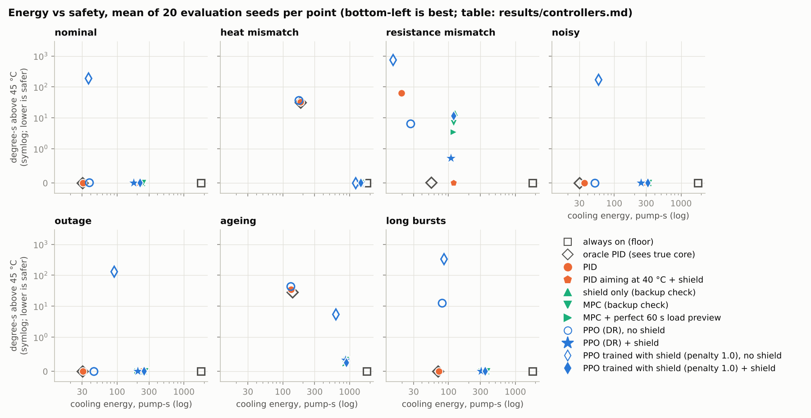
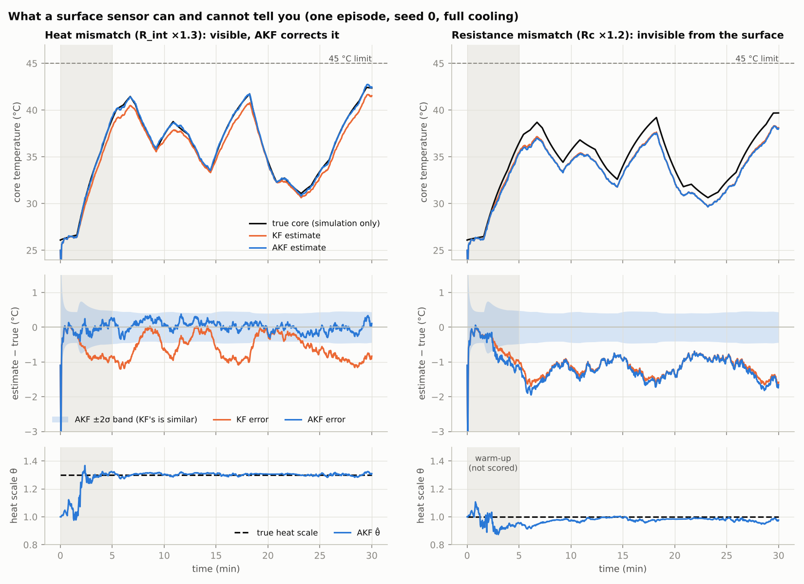
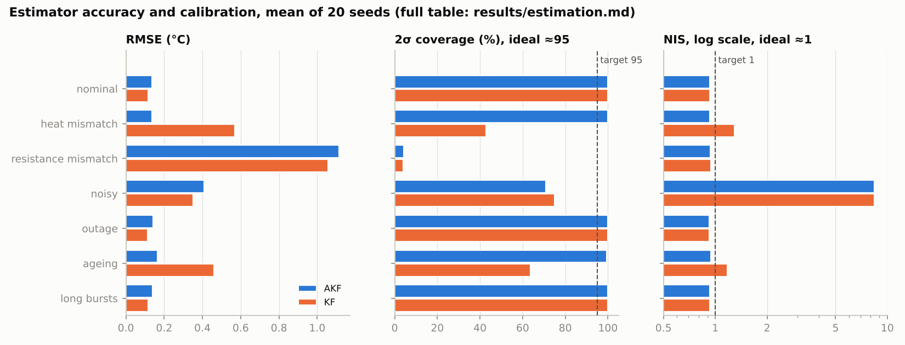
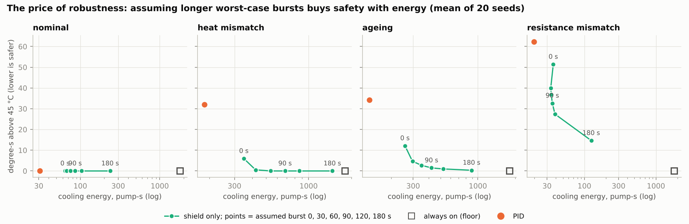
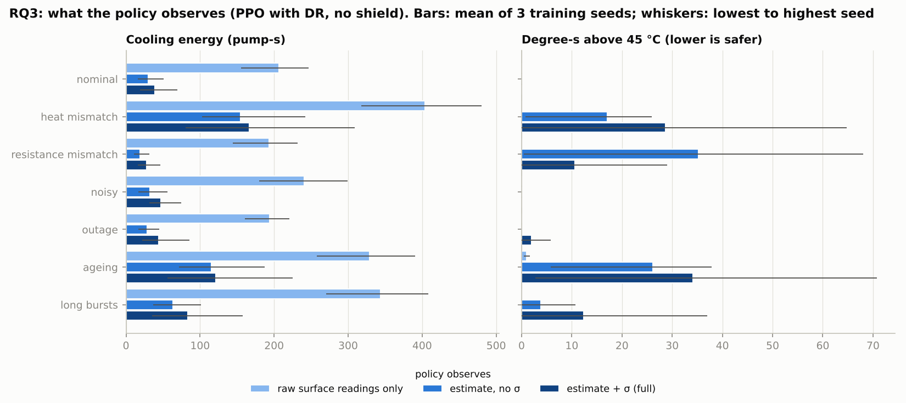
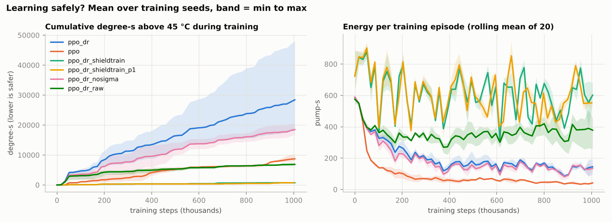

# 部分可观测条件下电池热管理的安全强化学习

[English](README.md) | **简体中文**

一个小型、可完全复现的演示：以电池为例，研究热管理系统中基于物理模型的状态估计与安全自适应控制。

**问题。**用尽量少的冷却能量，让电池的**核心温度 ≤ 45 °C**。只有**表面**温度能测量，带噪声，偶尔还会断开，而且模型本身可能不准。这个演示涉及四个研究问题：
- **RQ1：**估计无法测量的核心温度，并给出校准过的不确定性
- **RQ2：**带"感知不确定性的安全屏蔽"的安全强化学习
- **RQ3：**把估计和控制结合起来是否有帮助
- **RQ4：**对模型误差、传感器丢失和训练范围外工况的鲁棒性

所有内容都能在笔记本电脑的 CPU 上运行：整套流程（6 种 PPO 变体 × 3 个种子 × 100 万步，加上全部评估）在 4 核上大约一小时。

## 结果一览

1. **表面传感器能发现一部分模型误差，但不是全部（RQ1）。**一个同时估计电池发热量的卡尔曼滤波器，能发现并修正"发热比预期多"。但核心到表面的热阻错了时，**完全看不出来**：核心温度被低估约 1 °C，而所有一致性检查看起来都正常。
2. **安全来自"按最坏情况做规划"（RQ2）。**屏蔽会检查"如果来一段最坏的大电流，还扛得住吗？"，在估计准确的所有场景里都能把核心温度保持在 45 °C 以下。只往前看 30 秒的屏蔽做不到。
3. **PPO 加上这个屏蔽，在同等安全下最省电。**它比只用屏蔽少用 23 % 的能量（按回合取中位数），和一个**完美**知道未来 60 秒负载的 MPC 差不多一样省电。策略学会了预判负载、提前温和地冷却。
4. **估计"悄悄出错"的地方，留余量比聪明更管用（RQ3）。**在看不出来的热阻错误下，"PID 瞄准 40 °C + 屏蔽"和"不使用估计器的 PPO"都从未超过 45 °C，而依赖估计器的 PPO 策略有 18–52 % 的回合超温。用估计器让控制更高效，但控制器也会继承估计器的盲点。
5. **单独的 PPO 不安全；带屏蔽训练又会让它依赖屏蔽。**把屏蔽放进训练过程，学习期间的超温减少约 97 %。但即使把介入惩罚加大 10 倍，得到的策略在没有屏蔽时仍不安全。

| 控制器 | 正常场景能耗（泵·秒） | 发热失配：超温回合 | 热阻失配：超温回合 |
|---|---|---|---|
| 一直全开（全力冷却） | 1800 | 0 % | 0 % |
| PID | 31 | 85 % | 80 % |
| 只用屏蔽 | 237 | 0 % | 65 % |
| MPC | 245 | 0 % | 60 % |
| MPC + 完美的 60 秒负载预测 | 190 | 0 % | 55 % |
| PID 瞄准 40 °C + 屏蔽 | 211 | 0 % | **0 %** |
| PPO（DR），不加屏蔽 | 38 [24–59] | 50 % [5–75 %] | 30 % [0–55 %] |
| **PPO（DR）+ 屏蔽** | **178 [174–186]** | **0 %** | 18 % [0–40 %] |
| PPO，只看原始表面读数 + 屏蔽 | 382 | 0 % | **0 %** |

表中数字是每个控制器在同样 20 条评估电流曲线上的平均值。PPO 还在 3 个训练种子上取平均，方括号里是不同种子之间的范围。"泵·秒"是能耗单位，等于泵以满功率运行的秒数（一直全开 = 1800）。各种控制方法的解释见[控制方法通俗解释](#控制方法通俗解释)，"发热失配"和"热阻失配"的解释见[测试场景](#测试场景)。完整表格见 [results/controllers.md](results/controllers.md)。



## 模型

圆柱形电池的两状态集总热模型 [1, 2]：

```
Cc · dTc/dt = I²·R_int − (Tc − Ts)/Rc
Cs · dTs/dt = (Tc − Ts)/Rc − (Ts − Tf)·(h0 + h1·u)
```

- Tc 是核心温度（不可测），Ts 是表面温度（可测，噪声 σ = 0.3 °C），u ∈ [0, 1] 是冷却泵指令。泵的功率是 u³。
- Cc = 62.7 J/K、Cs = 4.5 J/K、Rc = 1.94 K/W 取自 Lin 等人 [2] 的 Table 1，是在一颗 2.3 Ah 的 A123 26650 磷酸铁锂电芯上辨识出来的。冷却映射 h(u) = 0.15 + 0.85·u W/K 是本演示的假设；[2] 中辨识的对流热阻（Ru = 3.19 K/W，即 h ≈ 0.31 W/K）落在这个范围之内。
- 25 A 下的稳态：全力冷却时 43.4 °C，不冷却时 78.8 °C，所以必须冷却。如果电池发热多 30 %，即使全力冷却也会到 48.9 °C，所以持续满负载时，有些超温在物理上无法避免。
- 每个 2 秒的时间步都是精确离散化的。电流曲线是随机的分段常数电流（0–25 A），偶尔出现 20–25 A、最长 180 秒的大电流段。每个控制器都在同样的 20 条随机电流曲线（种子 0–19）上评估。训练用的是全新的随机曲线，设计选择则在另一组种子（1000–1019）上调整。

## 控制方法通俗解释

| 方法 | 做什么 | 生活中的比方 |
|---|---|---|
| 卡尔曼滤波（KF / AKF） | 根据表面温度和模型，估计测不到的核心温度，并给出自己有多确定（σ）。AKF 还会估计电池实际产生了多少热量。下面除了理想 PID，所有控制器用的都是这个估计。 | 航海员根据船速、航向和偶尔看到的地标，推算船的位置。 |
| 一直全开 | 冷却始终开到最大。安全，但很浪费。 | 空调一整天都开到最大档。 |
| PID | 经典的反馈控制：估计的核心温度比目标高得越多，冷却就开得越大。简单、计算量小，但只能在温度已经升高之后才反应。 | 恒温器。 |
| 理想 PID | 和 PID 一样，但能看到真实的核心温度。现实中做不到，只用来参照。 | – |
| 安全屏蔽 | 夹在控制器和冷却泵之间的安全检查。每次执行前，它都会预测核心温度（连同不确定性），并问："如果这样做，接着又来一段最坏的大电流，全力冷却还能把核心保持在 44 °C 以下吗？"如果不能，就把冷却加到"刚好安全"的最小值。它只会加冷却，从不减冷却。"只用屏蔽"指单独使用屏蔽，每一步都选它认为安全的最小冷却量。 | 汽车的自动紧急刹车：平时由司机开车，系统只在快要撞车时才介入。 |
| MPC（模型预测控制） | 用模型试算未来 60 秒的许多种冷却计划，留下安全的，选出最省电的，只执行第一步，然后重新规划。工业中非常常用。"带负载预测"表示它还知道未来的电流。 | 下棋时往前多想几步，每走一步再重新想。 |
| PPO（强化学习） | 一个神经网络策略，在模拟环境里通过反复试错（一百万步）学出来：省电有奖励，超过 45 °C 有惩罚。训练好之后能瞬间做决定，但本身没有任何安全保证。"DR"（域随机化）表示训练时用了很多参数略有不同的电池，所以面对模型误差时更稳健。 | 在驾驶模拟器里练车。 |
| PPO + 屏蔽 | 学出来的策略提出冷却量，屏蔽只在必要时才介入。策略负责省电，屏蔽负责安全。 | 学车时，教练车副驾驶有第二个刹车踏板。 |
| PID 瞄准 40 °C + 屏蔽 | PID 的目标定在远低于屏蔽 44 °C 刹车线的地方，所以屏蔽很少需要介入。多出来的余量还能盖住滤波器看不见的误差。 | 跟车时留出比最低要求更大的车距。 |

## 测试场景

每个控制器都在 7 个场景下测试。所有场景里，估计器和控制器用的都是**标称**模型，只有模拟出来的"真实"电池或传感器发生变化。

| 场景 | 和模型相比哪里不一样 | 现实中可能的原因 |
|---|---|---|
| 正常 | 没有变化 | – |
| 发热失配 | 内阻 R_int ×1.3，电池实际发热比模型以为的多 30 % | 老化、低温、电池之间的个体差异 |
| 热阻失配 | 核心到表面的热阻 Rc ×1.2，热量从核心散出来比模型以为的更慢 | 制造差异、电池内部结构变化 |
| 传感器噪声 ×3 | 表面传感器的噪声是平时的 3 倍 | 传感器质量差或电磁干扰 |
| 传感器中断 | 表面传感器每次断开 30–120 秒，约 20 % 的时间离线 | 接触不良、传感器故障 |
| 老化 | 回合内 R_int 从 ×1.0 逐渐增大到 ×1.4，超出训练时见过的范围 | 电池衰退 |
| 长大电流段 | 满负载段持续 180–360 秒，而平时最长 180 秒 | 训练中没见过的负载模式 |

**为什么两种失配的表现差这么多？**把电池想象成一个穿着外套的人：身体是核心，会产生热量；外套是热阻 Rc；我们只能测到外套外面的温度。
- **发热失配**就像这个人在运动：散出来的热量变多，外套表面会比预测的更热。滤波器能从预测误差（NIS）里发现这些多出来的热量，AKF 也能把它修正过来。
- **热阻失配**就像外套比你以为的更厚：热量最后还是从表面散出去，所以外套表面的温度和预测的一模一样，但身体里面更热了。稳态时 Ts − Tf = Q/h，与 Rc 无关，所以表面传感器不含任何关于 Rc 的信息。核心温度会被低估约 1 °C，却没有任何信号报警。这就是为什么所有信任估计的控制器都在这个场景下失败。

## RQ1：表面传感器能告诉你什么、不能告诉你什么

有两个滤波器，都使用**标称**模型：
- **KF：**状态 [Tc, Ts]。它认定电池的发热量和模型说的完全一样（Q = I²·R_int）。
- **AKF**（增广卡尔曼滤波）：状态 [Tc, Ts, θ]，θ 是发热量的倍率（Q = θ·I²·R_int）。θ 从 1 开始缓慢变化，所以滤波器能学到电池实际产生了多少热量。

**通俗地说：**想象你用手摸锅的外壁来判断锅里水的温度，并且知道炉子开在几档。
- **KF** 认定炉子的火力和标签上写的完全一样。如果这个炉子其实比标签强 30 %，KF 就会一直低估水温，而且不知道自己错了。
- **AKF** 还会学"这个炉子实际有多强"。如果锅壁总是比预想的热，它就推断火力一定比标签大，并自动修正。
- **两个滤波器都学不到"热量穿过锅壁有多容易"**（也就是热阻 Rc），因为这在锅的外面不留痕迹。这就是热阻失配的情况。
- 屏蔽也会用 AKF 估出的 θ̂，所以发热偏多的电池会自动得到更大的冷却余量。





每个场景跑 20 个种子，全程全力冷却，这样只有估计器不同。完整数据见 [results/estimation.md](results/estimation.md)。

**怎么看这些估计指标。**其中一些需要知道真实的核心温度，所以只能在模拟里计算；另一些只用表面传感器，所以在真实电池上也能用来检查滤波器。

| 指标 | 含义 | 好的数值 | 需要真实核心温度吗？ |
|---|---|---|---|
| RMSE | 核心温度估计误差的典型大小（均方根，°C）。 | 越小越好 | 需要 |
| 偏差 | （估计值 − 真实值）的平均。负数表示估计偏低。 | ≈ 0 | 需要 |
| 2σ 覆盖率 | 真实核心温度落在滤波器自己给出的 ±2σ 区间内的时间比例，也就是它报告的不确定性是否诚实。 | ≈ 95 %。偏低说明过于自信，100 % 说明过于保守。 | 需要 |
| NEES | 归一化估计误差平方：实际误差除以滤波器声称的误差，再平方（针对 Tc 和 Ts 两个状态）。 | ≈ 2。偏大说明过于自信，偏小说明过于保守。 | 需要 |
| 新息（innovation） | 每次表面读数到来之前，滤波器都会先预测它。新息 = 实际读数 − 预测值。 | 随机，围绕 0 | 不需要 |
| NIS | 归一化新息平方：新息除以滤波器预期的大小，再平方。 | ≈ 1。明显大于 1 说明模型或噪声假设错了。 | **不需要** |
| 平均归一化新息 | 用同样方式缩放后的新息的平均值，看"意外"是否总是偏向同一边。 | ≈ 0。正数表示表面温度总是比预测的高。 | **不需要** |

NIS 就像检查一个天气预报员：他说"明天 20 °C，一般误差在 ±1 °C 以内"。你不需要懂气象学，只要比较他说的和实际发生的。如果他每天都差 3 °C，就说明有问题。它的局限是只能发现在表面上看得出来的错误，所以发现不了热阻失配。

下表中的偏差 = 估计值 − 真实值。

| 场景 | 结论 |
|---|---|
| 发热失配（R_int ×1.3） | **看得出来，也能修正。**普通 KF 偏低 0.48 °C，±2σ 区间只有 43 % 的时间包住真实值。它的新息（innovation）不需要核心传感器就能暴露问题：NIS 是 1.29 而不是 ≈1，平均归一化新息是 0.52 而不是 ≈0。AKF 估出 θ = 1.31，RMSE 回到 0.14 °C，区间全部覆盖真实值。 |
| 热阻失配（Rc ×1.2） | **看不出来。**两个滤波器都偏低约 1.0 °C，区间只有 4 % 的时间包住真实值，但新息看起来完全正常（NIS 0.94）。稳态时 Ts − Tf = Q/h，与 Rc 无关，所以表面传感器不含任何关于 Rc 的信息。 |
| 传感器噪声 ×3 | 滤波器假设 σ = 0.3 °C，NIS 跳到 8.4，所以能发现噪声假设错了。覆盖率降到 71–75 %。 |
| 老化（R_int ×1.0 → ×1.4） | KF 逐渐偏离（覆盖率 64 %）。AKF 能跟上（最后 θ̂ = 1.32，略滞后于真实的 1.4；覆盖率 99 %）。 |
| 传感器中断（每次断开 30–120 秒，约 20 % 的时间） | 全力冷却时，两个滤波器都保持准确。 |
| 正常 | 准确（RMSE 0.12–0.14 °C），但**偏保守**：NEES 是 0.4，而校准良好的滤波器应约为 2，说明 σ 比实际误差大。 |

## RQ2：控制器与安全屏蔽

除了"理想 PID"以外，所有控制器都使用 AKF 的估计。理想 PID 能看到真实核心温度，现实中做不到，只作参照。

| 控制器 | 规则 |
|---|---|
| 一直全开 | 始终 u = 1，是超温的物理下限。 |
| PID | 基于核心温度估计，目标 42 °C。增益在调参种子上用强化学习奖励的权重做网格搜索得到；搜索结果是纯比例控制（kp = 0.3）。 |
| 只用屏蔽，v1 | 选择最小的 u，使未来 30 秒内预测的核心温度均值 + 2σ ≤ 44 °C，并假设电流不变（原计划的设计）。 |
| **只用屏蔽** | 在 v1 基础上加一个**后备检查**：把 u 保持 30 秒，之后来一段最坏的大电流（25 A 持续 180 秒，电流曲线的最大值）时，全力冷却仍能扛住。它使用 AKF 估计的 θ̂，所以发热偏多的电池会自动留出更大的余量。 |
| MPC | 往前规划 60 秒（216 种候选计划，分成 3 段、每段 20 秒），在与屏蔽相同的安全规则下最小化 Σu³·dt。假设电流不变。 |
| MPC + 负载预测 | 同样的 MPC，但告诉它未来 60 秒的**真实**电流，代表负载预测能带来的收益上限。只在这段已知窗口之后才假设最坏的大电流。 |
| PID 瞄准 40 °C + 屏蔽 | 目标设为 40 °C 的 PID，屏蔽（上限 44 °C）作为最后保障。 |

**安全指标。***超温回合*：20 个测试回合中，真实核心温度在任何时刻超过 45 °C 的回合所占的比例。*超过 45 °C 的度·秒*：超出了多少、持续了多久，即 ∫ max(0, Tc − 45 °C) dt。例如超出 1 °C、持续 10 秒，就是 10 度·秒。

**结论**（每个场景 20 条评估电流曲线；表格见 [results/controllers.md](results/controllers.md)）：
- **发热失配时，PID，甚至理想 PID，都有 85 % 的回合超过 45 °C。**只会事后反应的控制器，知道真实温度也没用。v1 屏蔽有 40 % 的回合超温，带后备检查的屏蔽 0 %，而且比一直全开少用 18 % 的能量。
- **为什么需要后备检查。**在调参种子上，即使估计准确（误差约 0.1 °C），v1 屏蔽也会失败：核心已经比较热的时候来了一段大电流，这时全力冷却也压不到 45 °C 以下，而只往前看 30 秒是预见不到的。后备检查里把候选冷却量保持 30 秒（而不是一步），消除了"开—关"来回跳动，在安全性不变的情况下省电 25 %。
- **老化时**，所有带屏蔽的控制器唯一超温的回合，正是连一直全开也会超过 45 °C 的那一个。
- **热阻失配时，所有信任估计的控制器都会失败**（屏蔽和 MPC 有 55–65 % 的回合超温），而理想 PID 不会（5 %）。
- **负载预测大约值 20 %。**有完美 60 秒预测的 MPC 比没有时少用 15–22 % 的能量（按回合取中位数），安全性相同。
- **目标要定在刹车线以下。**PID 瞄准 40 °C、屏蔽在 44 °C 刹车，比只用屏蔽更省电（按场景，中位数省 6–10 %），而且是唯一在热阻失配下也安全的、依赖估计的控制器：5 °C 的余量盖住了估计器看不见的偏差。反过来直接把屏蔽的刹车线调低则代价很大（刹车线 40 °C 时正常能耗 1513，接近一直全开），因为温度每再低一度，需要的冷却都比上一度更多。

**鲁棒性的代价。**假设的最坏大电流段长度，就是在能耗和安全之间调节的旋钮：



## 强化学习：PPO 加与不加屏蔽

**设置。**PPO（stable-baselines3，64×64 的 MLP），每次训练 100 万步，每种变体 3 个训练种子。每次训练在单个 CPU 核上约 6 分钟，屏蔽在训练循环中时约 13–14 分钟。
- **奖励：**−u³ − 10·max(0, Tc − 45) − 0.01·|Δu|。使用真实核心温度（特权训练）。
- **观测：**策略永远看不到真实核心温度。它看到的是 AKF 的估计、σ、θ̂、最近一次表面读数、传感器是否在线、电流和上一步的 u。
- **训练条件：**每个回合都有额外的传感器噪声，一半回合有传感器中断。域随机化（DR）在每个回合随机抽取 R_int ×0.8–1.3 和 Rc ×0.8–1.2。

| 变体 | 测试什么 |
|---|---|
| `ppo_dr` | 主策略：完整观测，域随机化 |
| `ppo` | 同上，但不做域随机化 |
| `ppo_dr_nosigma`、`ppo_dr_raw` | RQ3：观测里没有 σ；完全不用估计器（只看最近 10 次表面读数） |
| `ppo_dr_shieldtrain`、`_p1` | 训练时屏蔽开启，介入惩罚分别为 0.1 和 1.0 |

**结论：**
1. **PPO + 屏蔽是最省电的安全控制器。**20 个正常回合里，它每一个都比只用屏蔽省电（中位数 −23 %），也每一个都比"PID 瞄准 40 °C + 屏蔽"省电（中位数 −15 %）。和有*完美* 60 秒负载预测的 MPC 比大致打平：20 个正常回合里有 12 个更省电，中位数 −6 %。[轨迹图](results/trajectory_nominal.png)能看出原因：PPO 提前、温和地冷却，屏蔽很少需要介入；而只用屏蔽和普通 MPC 都是最后一刻才猛烈冷却，在 u³ 的能耗下更费电。
2. **单独的 PPO 不安全。**即使做了域随机化，在发热失配下仍有 50 % 的回合超过 45 °C，老化下 40 %。不做域随机化更糟（发热失配下 87 %，平均超温 914 度·秒）。奖励里的惩罚项不等于安全保证。
3. **延长训练没有改变结论。**从 50 万步增加到 100 万步，PPO + 屏蔽的正常能耗从 174 变成 178 泵·秒，在种子之间的正常波动范围内。50 万步的结果保留在 [results/controllers_500k.md](results/controllers_500k.md)。

### RQ3：策略应该观测什么？



- **估计带来效率。**有 AKF 的估计时，PPO 在正常场景只需要 34–38 泵·秒。只看原始表面读数时需要 301（不同种子 203–351）：没有核心温度的估计，它就会留很大的余量。
- **σ 有帮助，主要是在模型出错的地方。**热阻失配下，有 σ 时 30 % 的回合超温，没有 σ 时 52 %；加上屏蔽后分别是 18 % 和 38 %。种子之间的范围有重叠，所以这是中等程度的效果。
- **只看原始读数的策略是最安全的 PPO。**加上屏蔽后，除了那个物理上无法避免的老化回合，它从未超过 45 °C，包括在热阻失配下，而在那里估计误导了所有依赖估计器的控制器。效率和鲁棒性在这里方向相反。到底该多信任估计器，正是 RQ3 所说的"估计与控制联合考虑"的问题。

### 安全探索：带屏蔽训练



| 变体 | 整个训练过程超过 45 °C 的度·秒 | 有超温的训练回合 | 训练最后 10 % 屏蔽介入比例 | 测试时不加屏蔽，正常回合超温比例 |
|---|---|---|---|---|
| PPO（DR） | 28 414 ± 16 972 | 16.6 % | – | 2 % |
| 屏蔽在训练中，惩罚 0.1 | 728 ± 12 | 2.2 % | 约 40 % | 75 % |
| 屏蔽在训练中，惩罚 1.0 | 742 ± 134 | 2.1 % | 13–21 % | 42 % [5–85 %] |

- 把屏蔽放进训练过程，学习期间的超温减少约 97 %。
- 惩罚较弱时，**策略学会了把安全工作完全交给屏蔽**，自己几乎不冷却。惩罚加大 10 倍后，对屏蔽的依赖减半，但没有屏蔽时仍不安全，而且结果很依赖训练种子。
- 加上屏蔽后，两种带屏蔽训练的策略都只比"只用屏蔽"略好一点（正常能耗 223–229 对 237 泵·秒）。不带屏蔽训练、部署时再加屏蔽的策略（178）明显更好。

完整表格见 [results/training_safety.md](results/training_safety.md)。

## 局限性

- 集总两状态热模型、假设的冷却映射，只有单个电芯（没有电池包，也没有冷却液动态）。
- 特权奖励：训练时使用了只有模拟器知道的真实核心温度。
- 屏蔽的保证只和估计以及大电流段假设一样可靠。它在热阻错误下会失败（RQ1），对于参数有偏差的电池，如果大电流段比假设的更长，也会失败。
- 如果参数有偏差的电池持续满负载运行，任何冷却策略都无法保持在 45 °C 以下，这时需要电池管理系统降低电流。
- MPC 是一个简单的枚举基线（6 档输入），不是调优过的工业级 MPC。带预测的版本是理想化的上限。
- 每种 PPO 变体只有 3 个训练种子，部分变体之间的差异落在种子之间的波动范围内。
- 滤波器的 σ 在正常场景下偏保守（NEES 0.4，理想值为 2）。

## 下一步

- **主动探测 / 对偶控制（dual control）**[5]：让核心到表面的热阻变得可观测，例如短暂改变冷却强度，激发出 Rc 会在表面温度上留下痕迹的瞬态过程。
- **带约束的强化学习**：例如对屏蔽介入或超温使用拉格朗日乘子，代替手工设定的惩罚，让策略自己学会留余量。这对应 García 与 Fernández 的安全强化学习分类 [3]：奖励惩罚改变的是优化目标，屏蔽则利用模型知识改变探索过程。
- 在策略或屏蔽中加入**负载预测**（在这里对 MPC 大约值 20 %）。
- **物理信息残差模型**（对集总模型做 PINN 或高斯过程修正 [4]），缩小滤波器看不见的未建模误差。
- 有形式化保证的**控制屏障函数（CBF）**屏蔽，以及把**降功率**作为第二个执行器。

## 复现

```bash
pip install -r requirements.txt
python -m pytest -q                 # 29 项检查：物理、滤波器、屏蔽、MPC、强化学习环境
python evaluate.py estimation       # RQ1（约 30 秒）
python evaluate.py tune-pid         # 在调参种子上搜索 PID 增益（4 核约 30 秒）
python evaluate.py shield-sweep     # 鲁棒性的代价（4 核约 1 分钟）
python run_all.py                   # 6 种 PPO 变体 × 3 个种子 × 100 万步（4 核约 45 分钟）
python evaluate.py training         # 训练过程中的安全性
python evaluate.py controllers      # 全部控制器，包括 PPO（4 核约 18 分钟）
```

不需要 GPU。在免费的云端机器上，可以用 `notebooks/colab_debug.ipynb` 快速测试，用 `notebooks/kaggle_train.ipynb` 跑完整训练（Accelerator 选 *None*，然后点 *Save & Run All*，关掉浏览器后也会继续运行）。

| 文件 | 内容 |
|---|---|
| `thermal_env.py` | 电池模型、精确离散化、电流曲线、场景、`ThermalSim`、`ObsBuilder` 和 Gymnasium 环境 `ThermalEnv` |
| `estimators.py` | `KalmanFilter(augment=False/True)`：KF 和 AKF，支持批量开环预测（电流恒定或已知未来电流） |
| `controllers.py` | 一直全开、PID、`PIDShield`、带 `BackupCheck` 的 `Shield`、只用屏蔽、MPC（可选负载预测）、`PPOController` |
| `train.py`、`run_all.py` | 带检查点和断点续训的 PPO 训练；并行跑所有变体 × 种子 |
| `evaluate.py` | 估计研究、PID 调参、控制器对比、屏蔽参数扫描、训练安全性 |
| `runs/` | 全部 18 次训练的最终策略（模型、归一化统计、配置、训练日志） |
| `tests/test_physics.py` | 单元测试，包括确认训练和评估构建的观测完全相同 |

## 参考文献

1. X. Lin, H. E. Perez, J. B. Siegel, A. G. Stefanopoulou, Y. Li, R. D. Anderson, Y. Ding, M. P. Castanier. Online parameterization of lumped thermal dynamics in cylindrical lithium ion batteries for core temperature estimation and health monitoring. *IEEE Transactions on Control Systems Technology*, 21(5):1745–1755, 2013.
2. X. Lin, H. E. Perez, S. Mohan, J. B. Siegel, A. G. Stefanopoulou, Y. Ding, M. P. Castanier. A lumped-parameter electro-thermal model for cylindrical batteries. *Journal of Power Sources*, 257:1–11, 2014. doi:10.1016/j.jpowsour.2014.01.097
3. J. García, F. Fernández. A comprehensive survey on safe reinforcement learning. *Journal of Machine Learning Research*, 16:1437–1480, 2015.
4. M. Raissi, P. Perdikaris, G. E. Karniadakis. Physics-informed neural networks: a deep learning framework for solving forward and inverse problems involving nonlinear partial differential equations. *Journal of Computational Physics*, 378:686–707, 2019.
5. A. Mesbah. Stochastic model predictive control with active uncertainty learning: a survey on dual control. *Annual Reviews in Control*, 45:107–117, 2018.
